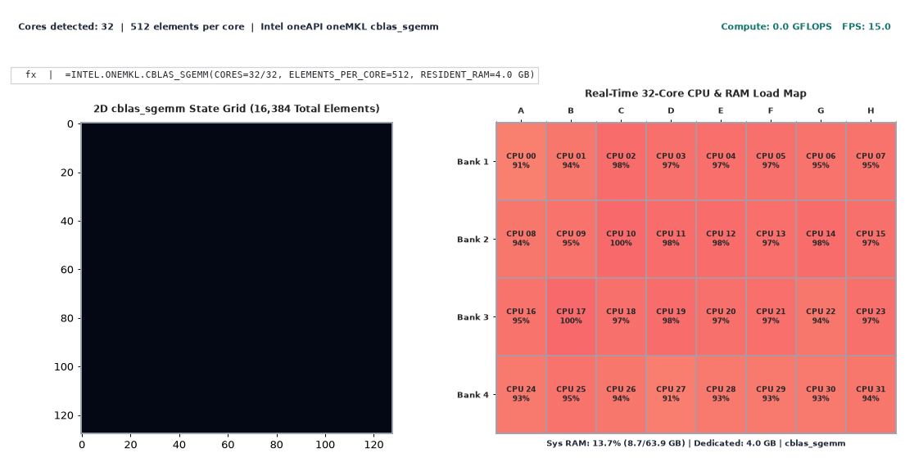

# `mklgemm-grid-monitor` — Intel® oneMKL `cblas_sgemm` & Memory Telemetry Grid

A Python + CBLAS multi-process compute engine and live desktop monitor ([`mklgemm-grid-monitor`](https://github.com/alexanderpashaliev44/mklgemm-grid-monitor)) built directly on **Intel® oneAPI Math Kernel Library (`oneMKL`) `cblas_sgemm`**. It automatically detects logical core count $N$, spawns $N$ OS-pinned worker processes (`SetProcessAffinityMask`), allocates **512 FP32 elements per logical core** ($N \times 512$ total elements), exercises controllable physical DRAM arenas, and plots real-time `cblas_sgemm` grid evolution alongside a per-core CPU & RAM utilization heatmap.

**Hardware / SIMD Target:** Multi-Core x86-64 Intel CPU (`AVX2` / `FMA3` / `AVX-512` via Intel® `oneMKL`)  
**Execution Backend:** Direct `ctypes` Dispatch to `Intel(R) oneAPI Math Kernel Library` (`mkl_rt.2.dll` $\rightarrow$ `cblas_sgemm`, `MKL_THREADING_SEQUENTIAL`) + `TkAgg` Dual-Panel GUI

---

## Core Thesis

> *"Symmetric multi-core throughput scaling and predictable memory-bandwidth pressure require eliminating runtime thread migration and Python GIL contention by pinning sequential SIMD BLAS kernels 1-to-1 onto OS-scheduled logical cores."*

---

## Live Dual-Panel Execution & 32-Thread `cblas_sgemm` Telemetry

<p align="center">
  
</p>

---

## What This Project Does

Instead of relying on single-process multi-threaded BLAS pooling (where Windows thread scheduling frequently causes uneven core migration or `OpenBLAS` fallback), `mklgemm-grid-monitor` enforces deterministic 1:1 hardware mapping:

1. **Dynamic Universal Core Allocation (`512` Elements per Core):** Auto-detects `os.cpu_count()` at startup and allocates `512` single-precision (`float32`) state elements per logical processor—scaling natively across any Intel processor (`32`-thread Xeon $\rightarrow$ `16,384` elements; `16`-thread $\rightarrow$ `8,192`; `8`-thread $\rightarrow$ `4,096`; `4`-thread i5 $\rightarrow$ `2,048`).
2. **Direct Intel® oneAPI `cblas_sgemm` Execution:** Bypasses `NumPy`'s bundled OpenBLAS backend by loading `mkl_rt.2.dll` via `ctypes`, configuring `MKL_Set_Threading_Layer(MKL_THREADING_SEQUENTIAL=1)` inside each pinned child process, and executing raw row-major `cblas_sgemm` operations (`2 * 512^3 + 2 * 512^2 = 268,959,744` FLOPs per worker step).
3. **Interactive Real-Time Core & Memory Control:** Embedded borderless ribbon dropdowns let you dynamically clamp **Active Cores** (`All`, `24`, `16`, `8`, `4`, `2`, `1` Core — immediately parking disabled cores at `IDLE` / `0%`) and scale **RAM Load** (`512 MB/Core` down to `16 MB/Core` per worker).
4. **Hardware-Verified 1-Second GFLOPS Metering:** Each worker atomically increments an unsigned 64-bit shared step counter (`ctypes.c_ulonglong`), enabling exact rolling 1-second GFLOPS telemetry without synthetic estimation.

---

## How It Works (Architecture & Stack)

| Pipeline Stage | Implementation / API | Dimensions / Allocation | Architectural Role |
| :--- | :--- | :---: | :--- |
| **1. Process Isolation & Affinity** | `multiprocessing.Process` + Win32 `SetProcessAffinityMask` | `1` process / logical core (`1 << core_id`) | Eliminates Python GIL contention and OS core hopping |
| **2. BLAS Binding (`oneMKL`)** | `ctypes.CDLL("mkl_rt.2.dll")` $\rightarrow$ `MKL_Set_Threading_Layer(1)` | Sequential ISA kernel (`mkl_avx2.2.dll` / `mkl_avx512.2.dll`) | Ensures deterministic per-core SIMD `VFMADD` execution |
| **3. Dense GEMM Kernel** | `cblas_sgemm(101, 111, 111, 512, 512, 512, ...)` + `[1 x 512]` state step | `268,959,744` FLOPs / worker step | Recurrent dense matrix multiplication & leaky clip `[0, 1]` |
| **4. Shared State & Telemetry** | `mp.RawArray(c_float)` + `mp.RawArray(c_ulonglong)` | `N * 512` `FP32` elements + step counters | Zero-copy state grid publishing & exact GFLOPS sampling |
| **5. Resident DRAM Arena** | Pre-allocated per-worker `np.float32` buffer + strided writes | `16` to `512 MB` per active core (`up to 16 GB` @ 32C) | Sustained main-memory bus traffic beyond L1/L2/L3 cache |
| **6. Spreadsheet-Style HUD** | `Matplotlib` (`TkAgg`) + `ttk.Combobox` + `psutil` | Dual grid (`Elements` vs `Bank x Core %`) | Formula bar `=INTEL.ONEMKL.CBLAS_SGEMM(...)` & live telemetry |

### Observed Host Verification (`Intel Xeon E5-2698 v3`, 32 Logical Cores)
* **Detected Backend:** `Intel(R) oneAPI Math Kernel Library Version 2025.1-Product Build 20250306 for Intel(R) 64 architecture applications | cblas_sgemm`
* **Grid Allocation:** `32` pinned processes $\times$ `512` elements/core = **`16,384` active elements** (`128 x 128` 2D grid)
* **Measured Compute:** **`375.75 GFLOPS`** (`1.2s` rolling sample across 32 pinned cores @ `128 MB/Core` RAM arena)

---

## Required Dependencies

### Python Packages (`requirements.txt`)
* [`numpy>=1.26.0`](https://numpy.org/) — Contiguous `float32` buffer allocation, RNG initialization, and BLAS fallback
* [`matplotlib>=3.8.0`](https://matplotlib.org/) — Dual-panel 2D matrix & heatmap renderer (`TkAgg` backend)
* [`psutil>=5.9.0`](https://psutil.org/) — Real-time per-core CPU utilization (`cpu_percent(percpu=True)`) and RAM telemetry
* [`pillow>=10.0.0`](https://python-pillow.org/) — Icon rendering / image I/O support
* **Python Standard Library:** `tkinter`, `multiprocessing`, `ctypes` (Win32 `kernel32.dll` affinity & `user32.dll` icon messaging)

### Intel Runtime (Optional for Direct `cblas_sgemm`, Automatic Fallback Included)
* **Intel® oneAPI Base Toolkit / Math Kernel Library (`oneMKL`):** Provides `mkl_rt.2.dll` (`MKLROOT\bin` or `C:\Program Files (x86)\Intel\oneAPI\mkl\latest\bin`). If `mkl_rt.2.dll` is not found on the host, [`mkl_worker.py`](./mkl_worker.py) automatically falls back to `NumPy` BLAS (`matmul`).

---

## Repository Files & How to Run

* [`main.py`](./main.py) — Spreadsheet-styled `TkAgg` monitor UI, unified borderless ribbon controls, custom favicon attachment, and 1-second GFLOPS/FPS loop.
* [`mkl_worker.py`](./mkl_worker.py) — `MklGemmGridEngine`, Win32 logical core affinity pinning, `oneMKL` `cblas_sgemm` dynamic loader, and shared-memory telemetry counters.
* [`run.bat`](./run.bat) — One-click Windows launcher.
* [`requirements.txt`](./requirements.txt) — Python package dependencies.
* [`assets/demo.gif`](./assets/demo.gif) — Live dual-panel execution showcase recording.
* [`assets/matrix_favicon.ico`](./assets/matrix_favicon.ico) — Custom bioluminescent matrix window & taskbar icon.

```powershell
# 1. Install Python dependencies
pip install -r requirements.txt

# 2. Launch interactive monitor
python main.py
```

---

## Limitations

* **Windows Affinity API:** Process pinning (`kernel32.SetProcessAffinityMask`) and `LoadImageW` taskbar icon calls target Windows (`win32`) and wrap cleanly in `try/except`; core affinity shifts to OS scheduling on Linux/macOS, and `1 << (core_id % 64)` assumes $\le 64$ logical processors within a single Windows processor group.
* **Thermal & Bandwidth Scaling:** Enabling `512 MB/Core` across `32` cores allocates `16 GB` of resident DRAM; on systems with smaller physical RAM, select lower `RAM Load` presets from the ribbon dropdown.

---

## References & Citations

* **Intel Corporation**, *"Developer Reference for Intel® oneAPI Math Kernel Library (oneMKL) — CBLAS Interface (`cblas_sgemm` & `MKL_Set_Threading_Layer`),"* Intel® oneAPI Documentation, 2025.
* **J. J. Dongarra, J. Du Croz, S. Hammarling, and I. S. Duff**, *"A Set of Level 3 Basic Linear Algebra Subprograms,"* ACM Transactions on Mathematical Software (TOMS), Vol. 16, No. 1, pp. 1–17, 1990.
* **K. Goto and R. A. van de Geijn**, *"Anatomy of High-Performance Matrix Multiplication,"* ACM Transactions on Mathematical Software (TOMS), Vol. 34, No. 3, Article 12, 2008.
* **S. Williams, A. Waterman, and D. Patterson**, *"Roofline: An Insightful Visual Performance Model for Multicore Architectures,"* Communications of the ACM, Vol. 52, No. 4, pp. 65–76, 2009.
* **G. M. Amdahl**, *"Validity of the Single Processor Approach to Achieving Large Scale Computing Capabilities,"* AFIPS Conference Proceedings, Vol. 30, pp. 483–485, 1967.
* **Microsoft Win32 API**, *`SetProcessAffinityMask` (`processthreadsapi.h`),* Microsoft Learn Platform SDK Documentation.
